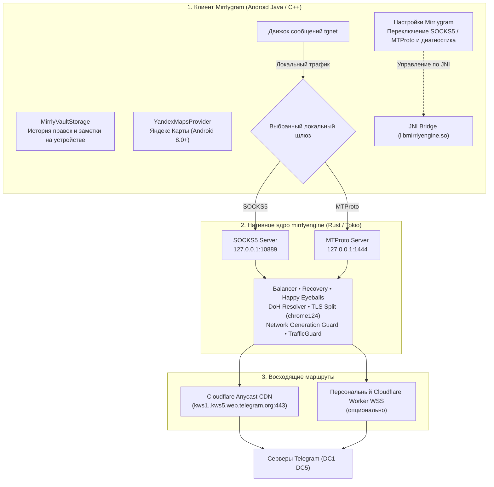

<div align="center">


# Mirrlygram для Android

**Открытый клиент Telegram на базе v13.2.2 со встроенным прокси-ядром `mirrlyengine` (Rust/Tokio), поддержкой SOCKS5, MTProto FakeTLS, Anycast CDN ([Flowseal](https://github.com/Flowseal)), Cloudflare Worker WSS, локальными заметками и Яндекс Картами**

<br/>

**[ 🇷🇺 Русский ](README.md)** &nbsp;|&nbsp; **[ 🇬🇧 English ](README_EN.md)** &nbsp;|&nbsp; **[ 🇮🇷 فارسی ](README_FA.md)**

<br/>

[-1E293B?logo=android&logoColor=3DDC84)](https://developer.android.com)
[-1E293B?logo=telegram&logoColor=26A5E4)](https://github.com/DrKLO/Telegram)
[](TMessagesProj)
[](mirrlyengine)
[](https://workers.cloudflare.com)
[](#3-ключевые-возможности-и-архитектурные-модули)
<br/>
[-1E293B?logo=github&logoColor=00E676)](https://github.com/joycecurcirt539-dot/MirrlyGram/releases)
[](#6-быстрый-старт-и-установка)
[](#5-интерфейс-приложения)
[](https://github.com/joycecurcirt539-dot/MirrlyGram/releases)
[](https://github.com/joycecurcirt539-dot/MirrlyGram/stargazers)
[](https://github.com/joycecurcirt539-dot/MirrlyGram/issues?q=is%3Aissue+is%3Aclosed)
[](https://github.com/joycecurcirt539-dot/MirrlyGram/issues)
<br/>
[](https://t.me/WhyOKyHb)
[](https://github.com/joycecurcirt539-dot/Mirrly-TG-Proxy)
[](#12-безопасность-приватность-и-лицензия)
[](Tools/clean_mirrlygram.ps1)
[](LICENSE)

*Открытый клиент Telegram для Android с автономным движком маршрутизации трафика из проекта Mirrly TG Proxy. Поддерживает протоколы SOCKS5 и MTProto FakeTLS, историю редактирования сообщений, офлайн-заметки на устройстве и Яндекс Карты без отдельного приложения-шлюза, root-прав и системного VPN.*

---

<h3>Поддержать разработку</h3>

Mirrlygram является бесплатным приложением с открытым исходным кодом. Поддержать дальнейшее развитие проекта можно банковской картой, через СБП, Mir Pay или Яндекс Пэй:

<br/>

[](https://pay.cloudtips.ru/p/e8c24aee)
&nbsp;
[](https://tips.yandex.ru/guest/payment/3754149)
&nbsp;
[](https://dalink.to/cartneyzix)

---

</div>

## Оглавление

1. [Что такое Mirrlygram](#1-что-такое-mirrlygram)
2. [Технический принцип работы](#2-технический-принцип-работы)
3. [Ключевые возможности и архитектурные модули](#3-ключевые-возможности-и-архитектурные-модули)
4. [Архитектура системы](#4-архитектура-системы)
5. [Интерфейс приложения](#5-интерфейс-приложения)
6. [Быстрый старт и установка](#6-быстрый-старт-и-установка)
7. [Конфигурация и параметры](#7-конфигурация-и-параметры)
8. [Структура проекта и сборка из исходного кода](#8-структура-проекта-и-сборка-из-исходного-кода)
9. [График активности разработки](#9-график-активности-разработки)
10. [Динамика звезд репозитория](#10-динамика-звезд-репозитория)
11. [Хронология и релизы](#11-хронология-и-релизы)
12. [Безопасность, приватность и лицензия](#12-безопасность-приватность-и-лицензия)
13. [Благодарности и ссылки](#13-благодарности-и-ссылки)

---

## 1. Что такое Mirrlygram

**Mirrlygram** (`com.mirrly.gram`) является модифицированным клиентом на базе открытого исходного кода [Telegram для Android](https://github.com/DrKLO/Telegram) (`13.2.2`, `7303`) со встроенным прокси-ядром из проекта [Mirrly TG Proxy](https://github.com/joycecurcirt539-dot/Mirrly-TG-Proxy).

В отличие от связки из стандартного мессенджера и отдельного прокси-клиента, **Mirrlygram** запускает нативное Rust-ядро `mirrlyengine` прямо внутри процесса приложения (`libmirrlyengine.so` через JNI). При первом запуске клиент поднимает локальный прокси-контур и синхронизирует профиль подключения без ручного ввода адресов и без создания системного `VpnService`.

Если нужен отдельный локальный шлюз для других клиентов Telegram или системный VPN на базе AmneziaWG/WireGuard, используйте приложение **[Mirrly TG Proxy](https://github.com/joycecurcirt539-dot/Mirrly-TG-Proxy)**.

### Статус и состав релиза

#### 1. Реализовано в релизе (`v13.2.2`)
* **Встроенное прокси-ядро (`mirrlyengine`)**:
  * **SOCKS5** (`127.0.0.1:10889`, активен по умолчанию при первом запуске): асинхронный TCP-релей с маршрутизацией через пул Cloudflare Anycast CDN или персональный Cloudflare Worker WSS.
  * **MTProto** (`127.0.0.1:1444`): локальный шлюз с автогенерацией секрета (`dd` при выключенном внешнем TLS, `ee` при включённом TLS) и пулом постоянных WebSocket-соединений к дата-центрам Telegram (`DC1`–`DC5`).
* **Обход фильтрации и устойчивость сети**:
  * Опциональная внешняя обёртка `TLS 1.2/1.3` (по умолчанию выключена, переключается в `Настройки Mirrlygram -> Сетевой движок`), фрагментация `ClientHello` и профиль отпечатка `chrome124`.
  * `Balancer`, `Recovery`, `Happy Eyeballs` (RFC 8305), `DoH`-резолвер, `Network Generation Guard` и `TrafficGuard` в Rust-ядре.
  * Автоматический подбор свободного локального порта при конфликте, сброс сокетов при смене сети или пробуждении экрана и ручной перезапуск (`Переподключить сокеты`).
* **Хранение истории правок и локальные заметки**:
  * **История изменений (`MirrlyVaultStorage`)**: локальное сохранение до `20` предыдущих версий отредактированных сообщений на устройстве с просмотром из контекстного меню.
  * **Чат заметок (`MirrlyNotesChatActivity`)**: локальные записи, привязка заметок к чатам и сообщениям со значком `mirrly_note_badge` в пузырях сообщений, поддержка офлайн-медиа, поиск, фильтры, закрепление, спойлеры, мультивыбор, редактирование и пересылка в чаты.
* **Карты, уведомления, медиа и интерфейс**:
  * **Яндекс Карты (`YandexMapsProvider`)**: просмотр и отправка геолокаций на базе Yandex MapKit `4.19.0-lite` (Android `8.0+`) с открытием маршрутов в Яндекс Картах.
  * **Фоновые уведомления (`NotificationsService`)**: постоянный канал уведомлений с keepalive каждые `3` минуты и быстрым переходом к снятию ограничений батареи и системных уведомлений.
  * **Чаты и медиа**: подтверждение отправки стикеров и выбор задней камеры по умолчанию для записи видеосообщений (кружков).
  * **Три языка**: локализация собственных экранов и системных диалогов на русский, английский и персидский языки (`RU`, `EN`, `FA`).

---

## 2. Технический принцип работы

Движок сообщений `tgnet` внутри клиента подключается к локальному сокету `127.0.0.1`, который обслуживается встроенной библиотекой `libmirrlyengine.so` (Rust/Tokio):

### Маршрут 1: Локальный SOCKS5 (`127.0.0.1:10889`, по умолчанию)
1. При первом запуске `MirrlyEngineController` активирует локальный профиль `SOCKS5` на `127.0.0.1:10889`. Если порт занят, выбирается первый свободный порт в диапазоне `10889..10938`.
2. Ядро `mirrlyengine` (`socks5.rs`, `cfproxy.rs`, `ws.rs`) принимает локальные соединения `tgnet` и направляет трафик через встроенный пул Cloudflare Anycast CDN или персональный Cloudflare Worker WSS.
3. При смене Wi-Fi / сотовой сети или выходе устройства из сна `ConnectionsManager` и `ScreenReceiver` уведомляют ядро для сброса зависших сокетов и перехода на новое поколение сети (`generation_guard.rs`).

### Маршрут 2: Локальный MTProto (`127.0.0.1:1444`)
1. Переключение на `MTProto` выполняется в один тап в разделе `Настройки Mirrlygram -> Сетевой движок`. Если порт `1444` занят, выбирается свободный порт из `1444..1493`.
2. Модуль `MirrlyEngineController` генерирует 34-символьный секрет (`dd` при отключённой внешней обёртке TLS, `ee` при включённой).
3. Шлюз (`proxy.rs`, `faketls.rs`, `ws.rs`) разбирает входящий поток, определяет целевой дата-центр (`DC1`–`DC5`) и устанавливает постоянные WebSocket-подключения к `kws1..kws5.web.telegram.org` через `Balancer`, `DoH` и `Happy Eyeballs`.

---

## 3. Ключевые возможности и архитектурные модули

### Сетевой стек `mirrlyengine`
* **Управление TLS и фрагментацией**: внешнее шифрование `TLS 1.2/1.3` по умолчанию отключено для стабильности на мобильных сетях и включается в разделе `Сетевой движок` вместе с фрагментацией `ClientHello` (`chrome124`).
* **Изоляция поколений сети (`generation_guard.rs`)**: при переключении интерфейса (Wi-Fi <-> LTE) сокеты предыдущего поколения инвалидируются, исключая долгие таймауты.
* **Балансировка и восстановление (`balancer.rs`, `recovery.rs`, `budget.rs`, `traffic_guard.rs`)**: выбор маршрута по задержкам для каждого дата-центра, контроль бюджета подключений и дедупликация DoH-запросов.
* **Диагностика в реальном времени**: окно диагностики отображает активный режим и адрес, время работы, число активных и общих соединений, счётчики ошибок WebSocket и сбросов, переданный/принятый трафик и кнопку копирования отчёта.

### Локальное хранилище (`MirrlyVaultStorage`) и чат заметок (`MirrlyNotesChatActivity`)
* **История редактирования сообщений**: автоматически фиксирует до `20` прошлых версий отредактированных сообщений в локальном хранилище устройства. Просмотр истории и её очистка управляются в разделе `Хранилище и заметки`.
* **Заметки к сообщениям, чатам и отдельные записи**: заметку можно прикрепить к конкретному сообщению, ко всему чату или создать напрямую в чате заметок. Сообщения с прикреплённой заметкой отмечаются значком `mirrly_note_badge`.
* **Офлайн-медиа в заметках**: поддерживаются фото, видео, видеосообщения, голосовые сообщения, аудио, файлы, стикеры, GIF, геолокации, контакты, опросы и форматированный текст.
* **Навигация и работа с базой**: поиск по тексту со счётчиком совпадений, фильтры по категориям (`Все`, `К сообщениям`, `Записи`, `Медиа`, `Файлы`, `Голосовые`, `Спойлер`), закреплённая верхняя заметка, скрытие текста спойлером, мультивыбор, редактирование и пересылка заметок в чаты.

### Карты, фоновые уведомления и поведение в чатах
* **Яндекс Карты (`YandexMapsProvider`)**: используется по умолчанию для просмотра и отправки геолокаций на Android `8.0+`, с открытием маршрутов в приложении или веб-версии Яндекс Карт.
* **Надёжность уведомлений (`NotificationsService`)**: постоянное фоновое уведомление, keepalive через `AlarmManager` каждые `3` минуты и короткий `WakeLock`; в настройках уведомлений выведены пункты проверки исключений оптимизации батареи и состояния системных уведомлений.
* **Настройки чатов (`MirrlyChatsSettingsActivity`)**: переключатели подтверждения отправки стикеров и использования задней камеры по умолчанию для записи кружков.

---

## 4. Архитектура системы



---

## 5. Интерфейс приложения

Пользовательский интерфейс собственных разделов построен на штатных компонентах Telegram (`BaseFragment`, `UniversalFragment`, `UniversalRecyclerView`, `UItem`, `FrostedBottomSheet`, `BulletinFactory`) с динамической темизацией `Theme.getColor(...)` и поддержкой трёх языков (`RU`, `EN`, `FA` с RTL):

* **Настройки Mirrlygram (`MirrlyGramSettingsActivity`)**: главный хаб с брендированной карточкой, живым баннером телеметрии `mirrlyengine`, быстрым переходом к поддержке проекта и поиском по всем настройкам Mirrlygram. Долгое нажатие на баннер открывает контекстное меню быстрого переключения транспорта.
* **Сетевой движок (`MirrlyNetworkSettingsActivity`)**: сегментированный переключатель `SOCKS5` / `MTProto`, настройки `TLS 1.2/1.3` и фрагментации `TLS`, кнопка `Переподключить сокеты` и переход в список прокси Telegram.
* **Хранилище и заметки (`MirrlyVaultSettingsActivity`, `MirrlyNotesChatActivity`, `MirrlyVaultSheets`)**: переход в чат заметок со счётчиком записей, очистка заметок, переключатель и очистка истории правок, матовые шторки просмотра версий сообщений и заметок.
* **Чаты и медиа (`MirrlyChatsSettingsActivity`)**: подтверждение отправки стикеров и задняя камера для видеосообщений.
* **О Mirrlygram (`MirrlyAboutActivity`)**: вкладки `О проекте` и `Поддержать` со ссылками на репозитории, Telegram-канал `@WhyOKyHb`, лицензию `GNU GPLv3` и сервисы поддержки (`CloudTips`, `Яндекс Чаевые`, `DaLink`).

---

## 6. Быстрый старт и установка

1. Скачайте установочный пакет со страницы [GitHub Releases](https://github.com/joycecurcirt539-dot/MirrlyGram/releases).
2. Выберите подходящий APK для устройства на Android `6.0+` (`API 23`–`36`, `versionCode 73039`):
   * **`MirrlyGram-13.2.2-universal-release.apk`**: универсальная ARM-сборка (`arm64-v8a` + `armeabi-v7a`). Подходит для большинства смартфонов и планшетов.
   * **`MirrlyGram-13.2.2-arm64-v8a-release.apk`**: сборка только для 64-битных ARM-устройств с меньшим размером файла.
   * **`MirrlyGram-13.2.2-armeabi-v7a-release.apk`**: сборка для 32-битных ARM-устройств.
   * Архитектуры `x86` и `x86_64` в этом релизе не собираются.
3. Проверьте контрольную сумму `SHA-256` скачанного файла по описанию релиза на GitHub и отпечаток релизного ключа подписи (`Release Keystore SHA-256`):
   `00:32:69:CB:70:12:DF:37:61:E7:D3:92:79:5C:C3:55:02:43:39:A4:B2:1B:3F:B5:75:A4:C9:2B:CC:DD:25:16`
4. Установите APK и войдите в аккаунт Telegram. Встроенный локальный прокси `mirrlyengine` запускается автоматически; переключить режим `SOCKS5` / `MTProto` или включить `TLS` можно в `Настройки -> Настройки Mirrlygram -> Сетевой движок`.

---

## 7. Конфигурация и параметры

Основные параметры `MirrlyConfig` и `MirrlyVaultStorage`, сохраняемые локально на устройстве:

| Параметр | По умолчанию | Описание |
| :--- | :--- | :--- |
| `effectiveSocks5Port` | `10889` | Локальный порт `SOCKS5` (при занятости выбирается свободный порт) |
| `effectiveMtprotoPort` | `1444` | Локальный порт `MTProto` (при занятости выбирается свободный порт) |
| `tlsEnabled` | `false` | Внешняя обёртка `TLS 1.2/1.3` (управляет префиксом секрета `dd`/`ee`) |
| `tlsClientHelloSplit` | `true` | Фрагментация `ClientHello` при включённом TLS (`chrome124`) |
| `cfProxyEnabled` | `true` | Маршрутизация через встроенный пул Cloudflare Anycast CDN |
| `workerDomain` | `""` | Персональный домен Cloudflare Worker WSS (опционально) |
| `saveEditHistory` | `true` | Сохранение до `20` локальных версий отредактированных сообщений |
| `confirmMediaSend` | `false` | Запрос подтверждения перед отправкой стикера |
| `roundVideoBackCamera` | `false` | Использование задней камеры по умолчанию для кружков |
| `mapProvider` | `1` (Yandex) | Встроенный провайдер Яндекс Карт (`Android 8.0+`) |

---

## 8. Структура проекта и сборка из исходного кода

### Дерево каталогов репозитория

```text
MirrlyGram V2/
├── TMessagesProj/                 # Основной модуль клиента (Java/C++, tgnet, ресурсы RU/EN/FA)
│   ├── jni/                       # Нативные C/C++ библиотеки Telegram (tgnet, BoringSSL, FFmpeg, WebRTC)
│   └── src/main/
│       ├── java/org/telegram/
│       │   ├── messenger/
│       │   │   ├── mirrly/        # MirrlyConfig, MirrlyEngineController, MirrlyVaultStorage, MirrlyBrandFormatter
│       │   │   ├── YandexMapsProvider.java
│       │   │   └── NotificationsService.java
│       │   └── ui/                # MirrlyGramSettingsActivity, MirrlyNetworkSettingsActivity,
│       │                          # MirrlyVaultSettingsActivity, MirrlyChatsSettingsActivity,
│       │                          # MirrlyNotesChatActivity, MirrlyAboutActivity, MirrlyUiKit, MirrlyVaultSheets
│       ├── jniLibs/               # Готовые libmirrlyengine.so (arm64-v8a, armeabi-v7a)
│       └── res/                   # Ресурсы и локализации (values, values-ru, values-fa)
├── TMessagesProj_App/             # Точка сборки релизных APK (afat / bundleAfat)
├── TMessagesProj_Modules/media/   # Модули Media3 (ExoPlayer и FFmpeg декодер)
├── mirrlyengine/                  # Нативное прокси-ядро на Rust (Tokio runtime)
│   ├── src/
│   │   ├── balancer.rs            # Балансировка доменов по дата-центрам и поколениям сети
│   │   ├── bridge.rs              # Жизненный цикл и управление рантаймом
│   │   ├── budget.rs              # Управление бюджетом соединений и дедупликация DoH
│   │   ├── cfproxy.rs             # Cloudflare Anycast CDN, DoH и Happy Eyeballs (RFC 8305)
│   │   ├── config.rs              # Параметры конфигурации ядра
│   │   ├── crypto.rs              # Криптографические примитивы и секреты
│   │   ├── faketls.rs             # FakeTLS маскировка и разбор потоков
│   │   ├── generation_guard.rs    # Защита от гонок поколений сети
│   │   ├── lib.rs                 # JNI-интерфейс (libmirrlyengine.so)
│   │   ├── network_profile.rs     # Сетевые профили и параметры сокетов
│   │   ├── node_independence.rs   # Изоляция узлов и маршрутов
│   │   ├── proxy.rs               # MTProto-шлюз и пул подключений
│   │   ├── recovery.rs            # Восстановление соединений и дренаж потоков
│   │   ├── socks5.rs              # SOCKS5-сервер (127.0.0.1:10889)
│   │   ├── tls_observability.rs   # Счётчики и телеметрия TLS-сессий
│   │   ├── traffic_guard.rs       # Контроль и учёт трафика
│   │   └── ws.rs                  # Транспорт WebSocket и TLS-фрагментация
│   ├── tests/                     # Интеграционные тесты Rust-ядра
│   └── Cargo.toml
├── Tools/                         # Утилиты сборки и очистки кэшей (clean_mirrlygram.ps1)
├── docs/assets/                   # Логотип проекта (logo.png)
├── buildSrc/ & gradle/            # Gradle Wrapper (8.13) и плагины сборки Telegram
└── build.gradle                   # Конфигурация сборки и копирование APK в release/
```

### Системные требования для сборки

* Java Development Kit (`JDK 17`)
* Gradle `8.13` / Android Gradle Plugin `8.13.2` (через `./gradlew`)
* Android SDK (`compileSdk 36`, `Build-Tools 36.0.0`, `minSdk 23`)
* Android NDK `27.2.12479018` и CMake `3.22.1`
* Rust Toolchain (`cargo`, `cargo-ndk`) только при пересборке `mirrlyengine` под `aarch64-linux-android` и `armv7-linux-androideabi` (готовые `libmirrlyengine.so` уже находятся в `TMessagesProj/src/main/jniLibs/`)

### Порядок сборки из консоли

1. Настройте `local.properties` в корне проекта:
   ```properties
   sdk.dir=PATH_TO_ANDROID_SDK
   # Опционально:
   YANDEX_MAPKIT_API_KEY=...
   GOOGLE_MAPS_API_KEY=...
   # Для собственной подписи релизной сборки:
   RELEASE_STORE_FILE=../TMessagesProj/config/mirrly-release.jks
   RELEASE_STORE_PASSWORD=...
   RELEASE_KEY_ALIAS=...
   RELEASE_KEY_PASSWORD=...
   ```
2. Запустите сборку:
   ```bash
   # Универсальный ARM APK (копируется в release/MirrlyGram-13.2.2-universal-release.apk)
   ./gradlew :TMessagesProj_App:assembleAfatRelease

   # Отдельные ABI
   ./gradlew :TMessagesProj_App:assembleAfatRelease -PsingleAbi=arm64-v8a
   ./gradlew :TMessagesProj_App:assembleAfatRelease -PsingleAbi=armeabi-v7a

   # Интеграционные и модульные тесты Rust-ядра
   cd mirrlyengine && cargo test
   ```
3. На Windows после сборки автоматически запускается [clean_mirrlygram.ps1](Tools/clean_mirrlygram.ps1) для удаления устаревших промежуточных кэшей Cargo/CMake с сохранением актуального кэша ARM-библиотек и папки `release/` (отключается флагом `-PskipAutoClean`).

---

## 9. График активности разработки

<div align="center">

[](https://github.com/joycecurcirt539-dot/MirrlyGram)

</div>

---

## 10. Динамика звезд репозитория

<a href="https://www.star-history.com/?repos=joycecurcirt539-dot%2FMirrlyGram&type=timeline&logscale=&releases=&legend=top-right">
 <picture>
   <source media="(prefers-color-scheme: dark)" srcset="https://api.star-history.com/chart?repos=joycecurcirt539-dot/MirrlyGram&type=timeline&theme=dark&logscale&legend=top-left" />
   <source media="(prefers-color-scheme: light)" srcset="https://api.star-history.com/chart?repos=joycecurcirt539-dot/MirrlyGram&type=timeline&logscale&legend=top-left" />
   
 </picture>
</a>

---

## 11. Хронология и релизы

| Версия / Этап | База Telegram | Ключевые изменения |
| :--- | :--- | :--- |
| **`v13.2.2`** (`73039`) | `13.2.2` (`7303`) | Первый публичный релиз: встроенное ядро `mirrlyengine` (`SOCKS5` + `MTProto`), локальная история правок до `20` версий, чат заметок с офлайн-медиа и значками в чатах, Яндекс Карты (`Android 8.0+`), фоновый keepalive уведомлений, локализации `RU / EN / FA` и подписанные ARM-сборки (`universal`, `arm64-v8a`, `armeabi-v7a`). |

---

## 12. Безопасность, приватность и лицензия

* **Локальное хранение данных**: история правок, локальные заметки и прикреплённые офлайн-медиа из `MirrlyVaultStorage` хранятся исключительно на устройстве и не передаются на внешние серверы.
* **Отсутствие сторонних трекеров**: в модификации Mirrlygram нет рекламных SDK или телеметрии.
* **Верификация сборок**: к каждому релизу на GitHub прилагаются контрольные отпечатки `SHA-256` всех установочных APK и официальный отпечаток ключа подписи (`00:32:69:CB:70:12:DF:37:61:E7:D3:92:79:5C:C3:55:02:43:39:A4:B2:1B:3F:B5:75:A4:C9:2B:CC:DD:25:16`).
* **Лицензия**: проект распространяется на условиях [GNU General Public License v3 (GNU GPLv3)](LICENSE) (исходная база [Telegram для Android](https://github.com/DrKLO/Telegram) под [GNU GPLv2+](https://github.com/DrKLO/Telegram/blob/master/LICENSE), встроенное ядро `mirrlyengine` под GNU GPLv3).

---

## 13. Благодарности и ссылки

* **[Telegram для Android (DrKLO)](https://github.com/DrKLO/Telegram)**: открытая кодовая база клиента `13.2.2` (`7303`), на основе которой собран Mirrlygram.
* **[Mirrly TG Proxy](https://github.com/joycecurcirt539-dot/Mirrly-TG-Proxy)**: родственный проект экосистемы Mirrly, откуда перенесено нативное Rust-ядро `mirrlyengine`.
* **[Flowseal](https://github.com/Flowseal)**: автор концепции маршрутизации трафика Telegram через Anycast CDN и WebSocket-сессии Cloudflare (`tg-ws-proxy`).
* **Официальный Telegram-канал**: [@WhyOKyHb](https://t.me/WhyOKyHb) (анонсы релизов и новости проекта).
* **Страница релизов**: [GitHub Releases](https://github.com/joycecurcirt539-dot/MirrlyGram/releases).
