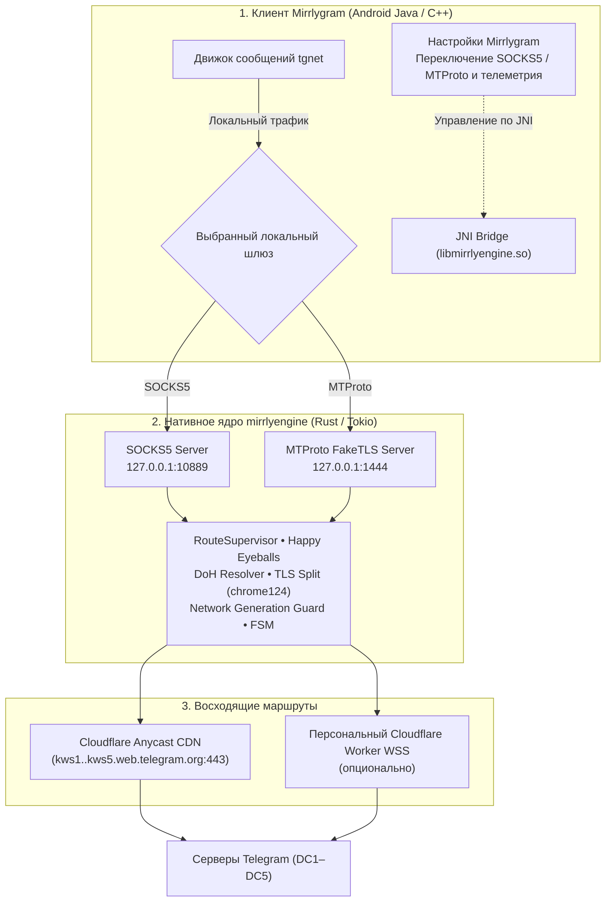

# Mirrlygram для Android

**Открытый клиент Telegram на базе v13.2.2 со встроенным прокси-ядром `mirrlyengine` (Rust/Tokio), локальной историей правок, заметками на устройстве и поддержкой Яндекс Карт**

 

[-1E293B?logo=telegram&logoColor=26A5E4)](https://github.com/DrKLO/Telegram)

[-1E293B?logo=android&logoColor=3DDC84)](https://developer.android.com)

 

*Первый публичный релиз исходного кода и установочных APK готовится к выходу на GitHub. Клиент объединяет привычный нативный интерфейс Telegram с автономным движком маршрутизации трафика из проекта Mirrly TG Proxy — без отдельного приложения-шлюза, root-прав и системного VPN.*

---

## Оглавление

1. [Что такое Mirrlygram](#1-что-такое-mirrlygram)
2. [Ключевые возможности](#2-ключевые-возможности)
3. [Встроенный сетевой стек mirrlyengine](#3-встроенный-сетевой-стек-mirrlyengine)
4. [Текущее состояние и подготовка к релизу](#4-текущее-состояние-и-подготовка-к-релизу)
5. [Приватность и безопасность](#5-приватность-и-безопасность)
6. [Ссылки и выход релиза](#6-ссылки-и-выход-релиза)

---

## 1. Что такое Mirrlygram

**Mirrlygram** (`com.mirrly.gram`) — модифицированный клиент на базе открытого исходного кода [Telegram для Android](https://github.com/DrKLO/Telegram), разрабатываемый автором [Mirrly TG Proxy](https://github.com/joycecurcirt539-dot/Mirrly-TG-Proxy) (`MirrlyDev / R1Xern`).

В отличие от связки из стандартного мессенджера и отдельного прокси-клиента, **Mirrlygram** запускает нативное Rust-ядро `mirrlyengine` прямо внутри приложения (`libmirrlyengine.so` через JNI). При первом запуске клиент автоматически поднимает локальный прокси-контур и синхронизирует профиль подключения без ручной настройки портов и без создания системного `VpnService`.

Если вам нужен отдельный локальный шлюз для других клиентов Telegram или генератор конфигураций WARP/AmneziaWG, используйте самостоятельное приложение **[Mirrly TG Proxy](https://github.com/joycecurcirt539-dot/Mirrly-TG-Proxy)**.

---

## 2. Ключевые возможности

### Встроенный прокси-движок (`mirrlyengine`)
* **Два локальных протокола на выбор**:
  * **SOCKS5** (`127.0.0.1:10889`): асинхронный TCP-релей с маршрутизацией через Anycast CDN и Cloudflare Worker WSS.
  * **MTProto FakeTLS** (`127.0.0.1:1444`): локальный шлюз с автоматической генерацией `ee`-секрета и пулом постоянных WebSocket-соединений к дата-центрам Telegram (DC1–DC5).
* **Обход фильтрации TLS**: опциональное шифрование транспортного канала TLS 1.2/1.3, фрагментация `ClientHello` и профиль отпечатка `chrome124`.
* **Живая телеметрия в настройках**: отображение активного протокола, числа открытых соединений и счётчиков переданного/принятого трафика в реальном времени, а также быстрый мягкий перезапуск сокетов (`Soft Reconnect`).

### Хранение истории правок и локальные заметки
* **История редактирования сообщений (`MirrlyVaultStorage`)**: локальная фиксация до 20 предыдущих версий отредактированных сообщений на устройстве с возможностью просмотра исходного текста из контекстного меню.
* **Чат заметок (`MirrlyNotesChatActivity`)**: встроенный локальный чат-блокнот для быстрых записей и привязки заметок к конкретным сообщениям с фильтрацией (все записи, заметки к сообщениям, отдельные заметки, спойлеры).

### Карты, медиа и нативный интерфейс
* **Поддержка Яндекс Карт (`YandexMapsProvider`)**: встроенный провайдер карт на базе Yandex MapKit для Android 8.0+ при просмотре и отправке геолокаций.
* **Контроль медиа и съёмки**: подтверждение отправки стикеров/медиа и выбор основной (тыловой) камеры по умолчанию для записи видеосообщений (кружков).
* **Нативный UI Telegram**: экраны настроек и раздела «О Mirrlygram» построены на штатных компонентах `BaseFragment` и `UniversalFragment` с поддержкой всех тем оформления Telegram и эффектов размытия `BaseFragmentSimpleGlass`.

---

## 3. Встроенный сетевой стек `mirrlyengine`

---

## 4. Текущее состояние и подготовка к релизу

Сейчас этот репозиторий служит стартовой страницей проекта перед публикацией исходного кода и первой релизной сборки.

### Что уже работает в текущей кодовой базе
* Базовый клиент на актуальной ветке [Telegram для Android](https://github.com/DrKLO/Telegram) `13.2.2` (`7303`, Android `6.0+`).
* Сборка нативного Rust-ядра `mirrlyengine` под все 4 архитектуры: `arm64-v8a`, `armeabi-v7a`, `x86_64`, `x86`.
* Автоматический старт прокси при запуске, переключение `SOCKS5` / `MTProto`, управление TLS и просмотр статистики в `MirrlyGramSettingsActivity`.
* Локальное хранилище истории правок (`MirrlyVaultStorage`), чат заметок (`MirrlyNotesChatActivity`) и интеграция Яндекс Карт.

### Что завершается перед первым публичным релизом
* Переработка визуального дизайна, уникальных векторных иконок и нативных анимаций экрана «О Mirrlygram» и собственных разделов настроек.
* Финальное тестирование сборок `Release` под 4 ABI на реальных сетях мобильных операторов и Wi-Fi.
* Публикация открытого дерева исходного кода, сборочных инструкций и подписанных пакетов APK с контрольными суммами SHA-256 в разделе [Releases](https://github.com/joycecurcirt539-dot/MirrlyGram/releases).

---

## 5. Приватность и безопасность

* **Локальное хранение данных**: история правок и заметки из `MirrlyVaultStorage` сохраняются исключительно в локальном хранилище устройства и не отправляются на сторонние серверы.
* **Отсутствие сторонних трекеров**: в модификации Mirrlygram нет рекламных SDK или телеметрии от разработчика.
* **Открытая лицензия**: проект распространяется на условиях свободной лицензии [GNU General Public License v3 (GNU GPLv3)](LICENSE) (исходная база [Telegram для Android](https://github.com/DrKLO/Telegram) — под [GNU GPLv2+](https://github.com/DrKLO/Telegram/blob/master/LICENSE), встроенное ядро `mirrlyengine` — под GNU GPLv3).
* **Верификация сборок**: к каждому публичному релизу на GitHub будут прилагаться контрольные отпечатки `SHA-256` для всех установочных APK и отпечаток релизного ключа подписи.

---

## 6. Ссылки и выход релиза

* **Анонсы и уведомление о выходе первого APK**: официальный Telegram-канал [@WhyOKyHb](https://t.me/WhyOKyHb)
* **Страница будущих релизов**: [GitHub Releases](https://github.com/joycecurcirt539-dot/MirrlyGram/releases)
* **Исходный репозиторий Telegram для Android**: [DrKLO/Telegram](https://github.com/DrKLO/Telegram)
* **Профиль разработчика**: [MirrlyDev (R1Xern)](https://github.com/joycecurcirt539-dot)
* **Связанный проект**: [Mirrly TG Proxy](https://github.com/joycecurcirt539-dot/Mirrly-TG-Proxy)
