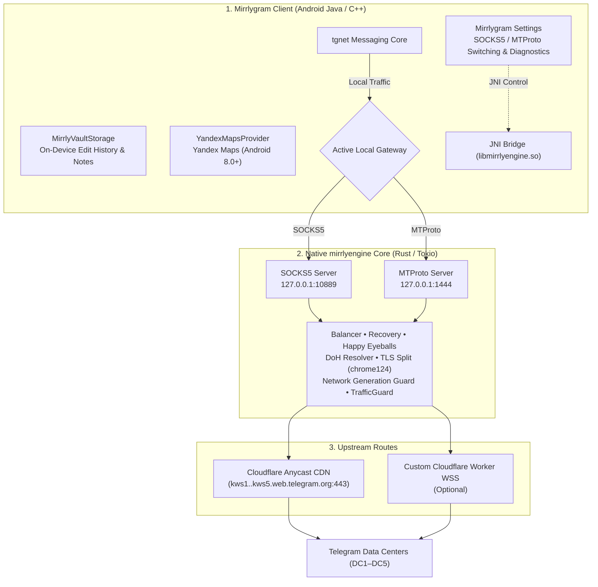

<div align="center">


# Mirrlygram for Android

**Open-source Telegram client based on v13.2.2 with the built-in `mirrlyengine` proxy core (Rust/Tokio), SOCKS5, MTProto FakeTLS, Anycast CDN ([Flowseal](https://github.com/Flowseal)), Cloudflare Worker WSS, local notes, and Yandex Maps**

<br/>

**[ 🇷🇺 Русский ](README.md)** &nbsp;|&nbsp; **[ 🇬🇧 English ](README_EN.md)** &nbsp;|&nbsp; **[ 🇮🇷 فارسی ](README_FA.md)**

<br/>

[-1E293B?logo=android&logoColor=3DDC84)](https://developer.android.com)
[-1E293B?logo=telegram&logoColor=26A5E4)](https://github.com/DrKLO/Telegram)
[](TMessagesProj)
[](mirrlyengine)
[](https://workers.cloudflare.com)
[](#3-key-features--architecture-modules)
<br/>
[-1E293B?logo=github&logoColor=00E676)](https://github.com/joycecurcirt539-dot/MirrlyGram/releases)
[](#6-quick-start--installation)
[](#5-application-ui)
[](https://github.com/joycecurcirt539-dot/MirrlyGram/releases)
[](https://github.com/joycecurcirt539-dot/MirrlyGram/stargazers)
[](https://github.com/joycecurcirt539-dot/MirrlyGram/issues?q=is%3Aissue+is%3Aclosed)
[](https://github.com/joycecurcirt539-dot/MirrlyGram/issues)
<br/>
[](https://t.me/WhyOKyHb)
[](https://github.com/joycecurcirt539-dot/Mirrly-TG-Proxy)
[](#12-security-privacy--license)
[](Tools/clean_mirrlygram.ps1)
[](LICENSE)

*Open-source Telegram client for Android with the standalone traffic routing core from Mirrly TG Proxy. Supports SOCKS5 and MTProto FakeTLS, message edit history, on-device offline notes, and Yandex Maps without a separate gateway app, root access, or system VPN.*

---

<h3>Support Development</h3>

Mirrlygram is a free and open-source application. You can support ongoing development by bank card, SBP, Mir Pay, or Yandex Pay:

<br/>

[](https://pay.cloudtips.ru/p/e8c24aee)
&nbsp;
[](https://tips.yandex.ru/guest/payment/3754149)
&nbsp;
[](https://dalink.to/cartneyzix)

---

</div>

## Table of Contents

1. [About Mirrlygram](#1-about-mirrlygram)
2. [How It Works](#2-how-it-works)
3. [Key Features & Architecture Modules](#3-key-features--architecture-modules)
4. [System Architecture](#4-system-architecture)
5. [Application UI](#5-application-ui)
6. [Quick Start & Installation](#6-quick-start--installation)
7. [Configuration & Parameters](#7-configuration--parameters)
8. [Project Structure & Building from Source](#8-project-structure--building-from-source)
9. [Development Activity Graph](#9-development-activity-graph)
10. [Star History](#10-star-history)
11. [Release History](#11-release-history)
12. [Security, Privacy & License](#12-security-privacy--license)
13. [Acknowledgements & Links](#13-acknowledgements--links)

---

## 1. About Mirrlygram

**Mirrlygram** (`com.mirrly.gram`) is a modified Android client built on the open-source [Telegram for Android](https://github.com/DrKLO/Telegram) codebase (`13.2.2`, `7303`) with the embedded proxy core from [Mirrly TG Proxy](https://github.com/joycecurcirt539-dot/Mirrly-TG-Proxy).

Instead of pairing a standard messenger with a standalone proxy app, **Mirrlygram** runs the native Rust core `mirrlyengine` directly inside the application process (`libmirrlyengine.so` via JNI). On first launch, the client starts the local proxy loop and configures the active profile automatically without manual port entry or a system `VpnService`.

If you need a standalone local gateway for other Telegram clients or a system-wide AmneziaWG/WireGuard VPN, use **[Mirrly TG Proxy](https://github.com/joycecurcirt539-dot/Mirrly-TG-Proxy)**.

### Release Status & Capabilities

#### 1. Shipped in Release (`v13.2.2`)
* **Built-in Proxy Engine (`mirrlyengine`)**:
  * **SOCKS5** (`127.0.0.1:10889`, active by default on first launch): asynchronous TCP relay routing through the Cloudflare Anycast CDN pool or an optional Cloudflare Worker WSS endpoint.
  * **MTProto** (`127.0.0.1:1444`): local gateway with automatic secret generation (`dd` when external TLS is off, `ee` when TLS is enabled) and persistent WebSocket pools to Telegram data centers (`DC1`–`DC5`).
* **Filtering Resilience & Network Stability**:
  * Optional outer `TLS 1.2/1.3` wrapper (off by default, toggleable in `Mirrlygram Settings -> Network Engine`), `ClientHello` fragmentation, and `chrome124` fingerprint profile.
  * `Balancer`, `Recovery`, `Happy Eyeballs` (RFC 8305), `DoH` resolver, `Network Generation Guard`, and `TrafficGuard` inside the Rust core.
  * Automatic fallback port selection on port conflict, socket reset on network switch or screen wake, and manual `Reconnect Sockets` action.
* **Edit History & Local Notes**:
  * **Message Edit History (`MirrlyVaultStorage`)**: saves up to `20` previous revisions of edited messages locally on the device, viewable from the message context menu.
  * **Local Notes Chat (`MirrlyNotesChatActivity`)**: standalone notes, chat-bound notes, and message-bound notes with a `mirrly_note_badge` indicator inside chat bubbles, offline media attachments, search, filters, pinning, spoilers, multi-select, editing, and forwarding back to chats.
* **Maps, Notifications, Media & UI**:
  * **Yandex Maps (`YandexMapsProvider`)**: location viewing and sharing via Yandex MapKit `4.19.0-lite` (Android `8.0+`) with route handoff to Yandex Maps.
  * **Background Notifications (`NotificationsService`)**: foreground push notification channel with a `3`-minute keepalive alarm and quick checks in Notification Settings for battery optimization exemption and OS notification permissions.
  * **Chats & Media**: sticker send confirmation dialog and default rear camera toggle for round video messages.
  * **Trilingual UI**: custom screens and system dialogs localized in English, Russian, and Persian (`EN`, `RU`, `FA`).

---

## 2. How It Works

Telegram's `tgnet` networking layer connects to a local `127.0.0.1` socket served by the embedded `libmirrlyengine.so` library (Rust/Tokio):

### Pipeline 1: Local SOCKS5 (`127.0.0.1:10889`, Default)
1. On initial startup, `MirrlyEngineController` preconfigures and enables the local `SOCKS5` profile on `127.0.0.1:10889`. If that port is already bound, it scans `10889..10938` for a free port.
2. `mirrlyengine` (`socks5.rs`, `cfproxy.rs`, `ws.rs`) accepts local `tgnet` connections and forwards traffic over the embedded Cloudflare Anycast CDN pool or a custom Cloudflare Worker WSS domain.
3. On Wi-Fi / cellular switches or device wake events, `ConnectionsManager` and `ScreenReceiver` notify the Rust core so stale sockets from previous network generations (`generation_guard.rs`) are invalidated immediately.

### Pipeline 2: Local MTProto (`127.0.0.1:1444`)
1. Users can switch to `MTProto` with one tap under `Mirrlygram Settings -> Network Engine`. If port `1444` is occupied, a free port in `1444..1493` is selected automatically.
2. `MirrlyEngineController` generates a 34-hex secret (`dd` prefix when outer TLS is disabled, `ee` prefix when enabled).
3. The gateway (`proxy.rs`, `faketls.rs`, `ws.rs`) inspects the incoming stream, determines the target data center (`DC1`–`DC5`), and opens persistent WebSocket sessions to `kws1..kws5.web.telegram.org` via `Balancer`, `DoH`, and `Happy Eyeballs`.

---

## 3. Key Features & Architecture Modules

### `mirrlyengine` Networking Core
* **TLS & Fragmentation Controls**: outer `TLS 1.2/1.3` encryption is disabled by default for better reliability on carrier networks and can be toggled in `Network Engine` along with `ClientHello` fragmentation (`chrome124`).
* **Network Generation Guard (`generation_guard.rs`)**: isolates socket generations across Wi-Fi <-> cellular transitions to prevent stalled sockets.
* **Balancing & Recovery (`balancer.rs`, `recovery.rs`, `budget.rs`, `traffic_guard.rs`)**: per-DC latency scoring, dial budget management, DoH request deduplication, and socket recovery.
* **Live Diagnostics**: the diagnostics sheet displays the active mode and local endpoint, engine uptime, active/total connection counts, WebSocket/reset error counts, session TX/RX traffic, and one-tap report copying.

### Local Vault (`MirrlyVaultStorage`) & Notes Chat (`MirrlyNotesChatActivity`)
* **Edit History**: stores up to `20` previous text revisions per edited message locally on the device. History capture and clearing are controlled in `Storage and Notes`.
* **Message, Chat & Standalone Notes**: attach notes to individual messages, whole chats, or write standalone entries inside the Local Notes chat. Messages with attached notes show a `mirrly_note_badge` icon inside the bubble.
* **Offline Media Notes**: supports photos, videos, round video messages, voice messages, audio files, documents, stickers, GIFs, locations, contacts, polls, and formatted text.
* **Search & Organization**: full-text search with match counters, filter chips (`All`, `Messages`, `Notes`, `Media`, `Files`, `Voice`, `Spoiler`), top pinned note banner, spoiler masking, multi-select actions, editing, and forwarding notes to Telegram chats.

### Maps, Background Push & Chat Behavior
* **Yandex Maps (`YandexMapsProvider`)**: default map provider for viewing and sending locations on Android `8.0+`, with route opening in the Yandex Maps app or web fallback.
* **Background Push Reliability (`NotificationsService`)**: persistent foreground notification channel, `3`-minute `AlarmManager` keepalive, short `WakeLock`, plus battery restriction and OS notification status rows in `Notifications and Sounds`.
* **Chats & Media (`MirrlyChatsSettingsActivity`)**: confirmation prompt before sending stickers and a setting to open the rear camera by default when recording video messages.

---

## 4. System Architecture



---

## 5. Application UI

Custom screens are built on native Telegram UI components (`BaseFragment`, `UniversalFragment`, `UniversalRecyclerView`, `UItem`, `FrostedBottomSheet`, `BulletinFactory`) with dynamic `Theme.getColor(...)` theming and trilingual localization (`EN`, `RU`, `FA` including RTL):

* **Mirrlygram Settings (`MirrlyGramSettingsActivity`)**: main settings hub with a branded hero card, live `mirrlyengine` telemetry banner, support banner, and search across all Mirrlygram sub-screens. Long-pressing the telemetry banner opens a quick transport switcher menu.
* **Network Engine (`MirrlyNetworkSettingsActivity`)**: segmented `SOCKS5` / `MTProto` selector, `TLS 1.2/1.3` and `TLS` split toggles, `Reconnect Sockets` button, and link to Telegram's proxy list.
* **Storage & Notes (`MirrlyVaultSettingsActivity`, `MirrlyNotesChatActivity`, `MirrlyVaultSheets`)**: notes chat entry with item counter, wipe confirmations, edit history toggle and counter, plus frosted bottom sheets for revisions and notes.
* **Chats & Media (`MirrlyChatsSettingsActivity`)**: sticker confirmation and rear camera for round video messages.
* **About Mirrlygram (`MirrlyAboutActivity`)**: `About` and `Support` tabs with repository links, `@WhyOKyHb` update channel, `GNU GPLv3` license details, and donation options (`CloudTips`, `Yandex Tips`, `DaLink`).

---

## 6. Quick Start & Installation

1. Download an installer package from [GitHub Releases](https://github.com/joycecurcirt539-dot/MirrlyGram/releases).
2. Choose the APK matching your Android `6.0+` (`API 23`–`36`, `versionCode 73039`) device:
   * **`MirrlyGram-13.2.2-universal-release.apk`**: universal ARM build containing both `arm64-v8a` and `armeabi-v7a` native libraries. Suitable for most phones and tablets.
   * **`MirrlyGram-13.2.2-arm64-v8a-release.apk`**: optimized for 64-bit ARM devices with a smaller download size.
   * **`MirrlyGram-13.2.2-armeabi-v7a-release.apk`**: for 32-bit ARM devices.
   * `x86` and `x86_64` builds are excluded from this release.
3. Verify the downloaded file's `SHA-256` checksum against the release notes and confirm the official signing certificate digest (`Release Keystore SHA-256`):
   `00:32:69:CB:70:12:DF:37:61:E7:D3:92:79:5C:C3:55:02:43:39:A4:B2:1B:3F:B5:75:A4:C9:2B:CC:DD:25:16`
4. Install the APK and sign in to Telegram. The embedded `mirrlyengine` proxy starts automatically; switch between `SOCKS5` and `MTProto` or configure `TLS` under `Settings -> Mirrlygram Settings -> Network Engine`.

---

## 7. Configuration & Parameters

Core `MirrlyConfig` and `MirrlyVaultStorage` preferences stored locally on the device:

| Parameter | Default | Description |
| :--- | :--- | :--- |
| `effectiveSocks5Port` | `10889` | Local `SOCKS5` port (auto-rebinds to a free port on conflict) |
| `effectiveMtprotoPort` | `1444` | Local `MTProto` port (auto-rebinds to a free port on conflict) |
| `tlsEnabled` | `false` | Outer `TLS 1.2/1.3` wrapper (controls `dd`/`ee` secret prefix) |
| `tlsClientHelloSplit` | `true` | `ClientHello` fragmentation when TLS is enabled (`chrome124`) |
| `cfProxyEnabled` | `true` | Routing through the embedded Cloudflare Anycast CDN pool |
| `workerDomain` | `""` | Custom Cloudflare Worker WSS domain (optional) |
| `saveEditHistory` | `true` | Stores up to `20` local revisions per edited message |
| `confirmMediaSend` | `false` | Confirmation dialog before sending stickers |
| `roundVideoBackCamera` | `false` | Defaults to rear camera when recording round video messages |
| `mapProvider` | `1` (Yandex) | Built-in Yandex Maps provider (`Android 8.0+`) |

---

## 8. Project Structure & Building from Source

### Repository Directory Tree

```text
MirrlyGram V2/
├── TMessagesProj/                 # Main client module (Java/C++, tgnet, RU/EN/FA resources)
│   ├── jni/                       # Telegram native C/C++ libs (tgnet, BoringSSL, FFmpeg, WebRTC)
│   └── src/main/
│       ├── java/org/telegram/
│       │   ├── messenger/
│       │   │   ├── mirrly/        # MirrlyConfig, MirrlyEngineController, MirrlyVaultStorage, MirrlyBrandFormatter
│       │   │   ├── YandexMapsProvider.java
│       │   │   └── NotificationsService.java
│       │   └── ui/                # MirrlyGramSettingsActivity, MirrlyNetworkSettingsActivity,
│       │                          # MirrlyVaultSettingsActivity, MirrlyChatsSettingsActivity,
│       │                          # MirrlyNotesChatActivity, MirrlyAboutActivity, MirrlyUiKit, MirrlyVaultSheets
│       ├── jniLibs/               # Prebuilt libmirrlyengine.so (arm64-v8a, armeabi-v7a)
│       └── res/                   # Resources and localizations (values, values-ru, values-fa)
├── TMessagesProj_App/             # Release APK application module (afat / bundleAfat)
├── TMessagesProj_Modules/media/   # Media3 modules (ExoPlayer & FFmpeg decoder)
├── mirrlyengine/                  # Native Rust proxy engine (Tokio runtime)
│   ├── src/
│   │   ├── balancer.rs            # Per-DC and network-generation domain scoring
│   │   ├── bridge.rs              # Runtime lifecycle and management
│   │   ├── budget.rs              # Dial budget control & DoH deduplication
│   │   ├── cfproxy.rs             # Cloudflare Anycast CDN, DoH & Happy Eyeballs (RFC 8305)
│   │   ├── config.rs              # Engine configuration structures
│   │   ├── crypto.rs              # Cryptographic primitives and secrets
│   │   ├── faketls.rs             # FakeTLS masquerading and framing
│   │   ├── generation_guard.rs    # Network generation race guard
│   │   ├── lib.rs                 # JNI bindings (libmirrlyengine.so)
│   │   ├── network_profile.rs     # Network profiles and socket tuning
│   │   ├── node_independence.rs   # Node and route isolation
│   │   ├── proxy.rs               # MTProto gateway and connection pool
│   │   ├── recovery.rs            # Connection recovery and flow draining
│   │   ├── socks5.rs              # SOCKS5 server (127.0.0.1:10889)
│   │   ├── tls_observability.rs   # TLS handshake counters and observability
│   │   ├── traffic_guard.rs       # Traffic accounting and guardrails
│   │   └── ws.rs                  # WebSocket transport and TLS fragmentation
│   ├── tests/                     # Rust core integration tests
│   └── Cargo.toml
├── Tools/                         # Build & cache cleanup utilities (clean_mirrlygram.ps1)
├── docs/assets/                   # Project logo (logo.png)
├── buildSrc/ & gradle/            # Gradle Wrapper (8.13) and Telegram build plugins
└── build.gradle                   # Build config and automatic copy to release/
```

### Build Requirements

* Java Development Kit (`JDK 17`)
* Gradle `8.13` / Android Gradle Plugin `8.13.2` (via `./gradlew`)
* Android SDK (`compileSdk 36`, `Build-Tools 36.0.0`, `minSdk 23`)
* Android NDK `27.2.12479018` and CMake `3.22.1`
* Rust Toolchain (`cargo`, `cargo-ndk`) only if rebuilding `mirrlyengine` for `aarch64-linux-android` and `armv7-linux-androideabi` (prebuilt `libmirrlyengine.so` binaries are included in `TMessagesProj/src/main/jniLibs/`)

### Building from Console

1. Configure `local.properties` in the repository root:
   ```properties
   sdk.dir=PATH_TO_ANDROID_SDK
   # Optional:
   YANDEX_MAPKIT_API_KEY=...
   GOOGLE_MAPS_API_KEY=...
   # Custom release signing:
   RELEASE_STORE_FILE=../TMessagesProj/config/mirrly-release.jks
   RELEASE_STORE_PASSWORD=...
   RELEASE_KEY_ALIAS=...
   RELEASE_KEY_PASSWORD=...
   ```
2. Run Gradle or Cargo commands:
   ```bash
   # Universal ARM APK (copied to release/MirrlyGram-13.2.2-universal-release.apk)
   ./gradlew :TMessagesProj_App:assembleAfatRelease

   # Single ABI builds
   ./gradlew :TMessagesProj_App:assembleAfatRelease -PsingleAbi=arm64-v8a
   ./gradlew :TMessagesProj_App:assembleAfatRelease -PsingleAbi=armeabi-v7a

   # Rust core tests
   cd mirrlyengine && cargo test
   ```
3. On Windows, [clean_mirrlygram.ps1](Tools/clean_mirrlygram.ps1) runs automatically after builds to prune stale Cargo/CMake intermediates while keeping the latest ARM C++ cache and `release/` directory (pass `-PskipAutoClean` to disable).

---

## 9. Development Activity Graph

<div align="center">

[](https://github.com/joycecurcirt539-dot/MirrlyGram)

</div>

---

## 10. Star History

<a href="https://www.star-history.com/?repos=joycecurcirt539-dot%2FMirrlyGram&type=timeline&logscale=&releases=&legend=top-right">
 <picture>
   <source media="(prefers-color-scheme: dark)" srcset="https://api.star-history.com/chart?repos=joycecurcirt539-dot/MirrlyGram&type=timeline&theme=dark&logscale&legend=top-left" />
   <source media="(prefers-color-scheme: light)" srcset="https://api.star-history.com/chart?repos=joycecurcirt539-dot/MirrlyGram&type=timeline&logscale&legend=top-left" />
   
 </picture>
</a>

---

## 11. Release History

| Version | Telegram Base | Summary |
| :--- | :--- | :--- |
| **`v13.2.2`** (`73039`) | `13.2.2` (`7303`) | First public release: embedded `mirrlyengine` (`SOCKS5` + `MTProto`), local message edit history (up to `20` revisions), notes chat with offline media and chat bubble badges, Yandex Maps (`Android 8.0+`), background notification keepalive, `RU / EN / FA` localizations, and signed ARM APKs (`universal`, `arm64-v8a`, `armeabi-v7a`). |

---

## 12. Security, Privacy & License

* **On-Device Storage**: message edit history, local notes, and offline media attachments in `MirrlyVaultStorage` stay exclusively on the device and are never uploaded to external servers.
* **No Tracking**: Mirrlygram includes no ad SDKs or telemetry.
* **Build Verification**: every GitHub release lists `SHA-256` checksums for all APKs alongside the official release signing certificate digest (`00:32:69:CB:70:12:DF:37:61:E7:D3:92:79:5C:C3:55:02:43:39:A4:B2:1B:3F:B5:75:A4:C9:2B:CC:DD:25:16`).
* **License**: distributed under [GNU General Public License v3 (GNU GPLv3)](LICENSE) (upstream [Telegram for Android](https://github.com/DrKLO/Telegram) under [GNU GPLv2+](https://github.com/DrKLO/Telegram/blob/master/LICENSE), embedded `mirrlyengine` core under GNU GPLv3).

---

## 13. Acknowledgements & Links

* **[Telegram for Android (DrKLO)](https://github.com/DrKLO/Telegram)**: open-source client base (`13.2.2`, `7303`) on which Mirrlygram is built.
* **[Mirrly TG Proxy](https://github.com/joycecurcirt539-dot/Mirrly-TG-Proxy)**: companion project in the Mirrly ecosystem providing the native `mirrlyengine` Rust core.
* **[Flowseal](https://github.com/Flowseal)**: author of the Anycast CDN and Cloudflare WebSocket Telegram routing concept (`tg-ws-proxy`).
* **Official Telegram Channel**: [@WhyOKyHb](https://t.me/WhyOKyHb) (release announcements and project updates).
* **Releases**: [GitHub Releases](https://github.com/joycecurcirt539-dot/MirrlyGram/releases).
