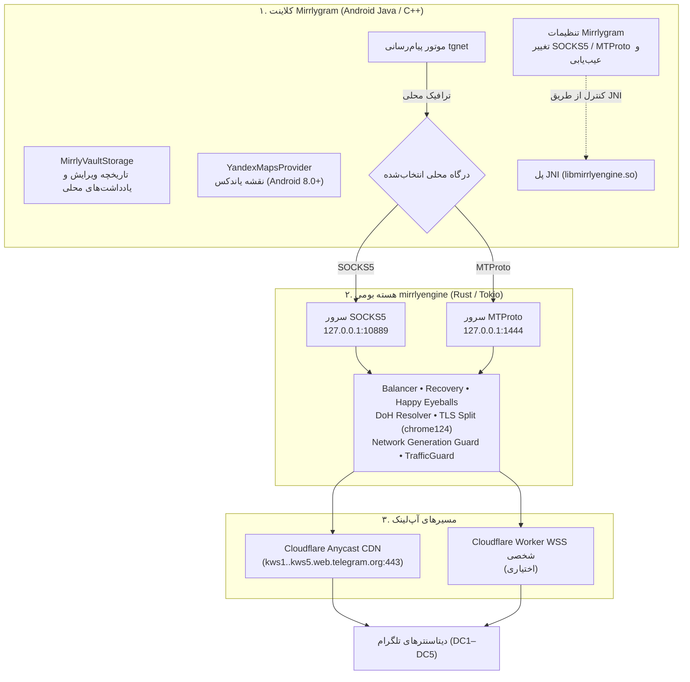

<div align="center">


# Mirrlygram برای اندروید

**کلاینت متن‌باز تلگرام بر پایه نسخه v13.2.2 با هسته پروکسی داخلی `mirrlyengine` (Rust/Tokio)، پشتیبانی از SOCKS5، MTProto FakeTLS، Anycast CDN ([Flowseal](https://github.com/Flowseal))، Cloudflare Worker WSS، یادداشت‌های محلی و نقشه‌های یاندکس**

<br/>

**[ 🇷🇺 Русский ](README.md)** &nbsp;|&nbsp; **[ 🇬🇧 English ](README_EN.md)** &nbsp;|&nbsp; **[ 🇮🇷 فارسی ](README_FA.md)**

<br/>

[-1E293B?logo=android&logoColor=3DDC84)](https://developer.android.com)
[-1E293B?logo=telegram&logoColor=26A5E4)](https://github.com/DrKLO/Telegram)
[](TMessagesProj)
[](mirrlyengine)
[](https://workers.cloudflare.com)
[](#3-قابلیتهای-کلیدی-و-معماری-ماژولها)
<br/>
[-1E293B?logo=github&logoColor=00E676)](https://github.com/joycecurcirt539-dot/MirrlyGram/releases)
[](#6-شروع-سریع-و-نصب)
[](#5-رابط-کاربری-برنامه)
[](https://github.com/joycecurcirt539-dot/MirrlyGram/releases)
[](https://github.com/joycecurcirt539-dot/MirrlyGram/stargazers)
[](https://github.com/joycecurcirt539-dot/MirrlyGram/issues?q=is%3Aissue+is%3Aclosed)
[](https://github.com/joycecurcirt539-dot/MirrlyGram/issues)
<br/>
[](https://t.me/WhyOKyHb)
[](https://github.com/joycecurcirt539-dot/Mirrly-TG-Proxy)
[](#12-امنیت-حریم-خصوصی-و-مجوز)
[](Tools/clean_mirrlygram.ps1)
[](LICENSE)

*کلاینت متن‌باز تلگرام برای اندروید همراه با موتور مستقل مسیریابی ترافیک از پروژه Mirrly TG Proxy. دارای پشتیبانی از پروتکل‌های SOCKS5 و MTProto FakeTLS، تاریخچه ویرایش پیام‌ها، یادداشت‌های آفلاین روی دستگاه و نقشه یاندکس بدون نیاز به برنامه گیت‌وی جداگانه، دسترسی روت یا VPN سیستمی.*

---

<h3>حمایت از توسعه</h3>

Mirrlygram یک برنامه رایگان و متن‌باز است. می‌توانید از ادامه توسعه پروژه با کارت بانکی، SBP، Mir Pay یا Yandex Pay حمایت کنید:

<br/>

[](https://pay.cloudtips.ru/p/e8c24aee)
&nbsp;
[](https://tips.yandex.ru/guest/payment/3754149)
&nbsp;
[](https://dalink.to/cartneyzix)

---

</div>

## فهرست مطالب

1. [Mirrlygram چیست](#1-mirrlygram-چیست)
2. [نحوه کارکرد فنی](#2-نحوه-کارکرد-فنی)
3. [قابلیت‌های کلیدی و معماری ماژول‌ها](#3-قابلیتهای-کلیدی-و-معماری-ماژولها)
4. [معماری سیستم](#4-معماری-سیستم)
5. [رابط کاربری برنامه](#5-رابط-کاربری-برنامه)
6. [شروع سریع و نصب](#6-شروع-سریع-و-نصب)
7. [پیکربندی و تنظیمات](#7-پیکربندی-و-تنظیمات)
8. [ساختار پروژه و بیلد از سورس‌کد](#8-ساختار-پروژه-و-بیلد-از-سورسکد)
9. [نمودار فعالیت توسعه](#9-نمودار-فعالیت-توسعه)
10. [تاریخچه ستاره‌های ریپازیتوری](#10-تاریخچه-ستارههای-ریپازیتوری)
11. [تاریخچه نسخه‌ها و انتشارها](#11-تاریخچه-نسخهها-و-انتشارها)
12. [امنیت، حریم خصوصی و مجوز](#12-امنیت-حریم-خصوصی-و-مجوز)
13. [قدردانی و لینک‌ها](#13-قدردانی-و-لینکها)

---

## 1. Mirrlygram چیست

**Mirrlygram** (`com.mirrly.gram`) یک کلاینت اندروید تغییریافته بر پایه سورس‌کد متن‌باز [تلگرام برای اندروید](https://github.com/DrKLO/Telegram) (`13.2.2`, `7303`) همراه با هسته پروکسی داخلی از پروژه [Mirrly TG Proxy](https://github.com/joycecurcirt539-dot/Mirrly-TG-Proxy) است.

برخلاف ترکیب پیام‌رسان استاندارد و یک برنامه پروکسی جداگانه، **Mirrlygram** هسته بومی Rust به نام `mirrlyengine` را مستقیماً در داخل پردازش برنامه (`libmirrlyengine.so` از طریق JNI) اجرا می‌کند. در اولین اجرا، کلاینت بدون نیاز به وارد کردن دستی پورت یا ایجاد `VpnService` سیستمی، مدار پروکسی محلی را راه‌اندازی و پروفایل اتصال را همگام‌سازی می‌کند.

اگر به یک گیت‌وی محلی مستقل برای سایر کلاینت‌های تلگرام یا VPN سیستمی بر پایه AmneziaWG/WireGuard نیاز دارید، از برنامه **[Mirrly TG Proxy](https://github.com/joycecurcirt539-dot/Mirrly-TG-Proxy)** استفاده کنید.

### وضعیت و محتوای انتشار

#### ۱. امکانات آماده در نسخه (`v13.2.2`)
* **موتور پروکسی داخلی (`mirrlyengine`)**:
  * **SOCKS5** (`127.0.0.1:10889`، فعال به صورت پیش‌فرض در اولین اجرا): رله ناهمگام TCP با مسیریابی از طریق استخر Cloudflare Anycast CDN یا Cloudflare Worker WSS اختیاری.
  * **MTProto** (`127.0.0.1:1444`): درگاه محلی با تولید خودکار کلید مخفی (`dd` هنگام غیرفعال بودن TLS خارجی، `ee` هنگام فعال بودن TLS) و استخر اتصالات دائمی WebSocket به دیتاسنترهای تلگرام (`DC1`–`DC5`).
* **مقاومت در برابر فیلترینگ و پایداری شبکه**:
  * لایه اختیاری `TLS 1.2/1.3` (به صورت پیش‌فرض خاموش است و در `تنظیمات Mirrlygram -> موتور شبکه` روشن می‌شود)، قطعه‌بندی `ClientHello` و پروفایل اثر انگشت `chrome124`.
  * ماژول‌های `Balancer`، `Recovery`، `Happy Eyeballs` (RFC 8305)، مفسر `DoH`، `Network Generation Guard` و `TrafficGuard` در هسته Rust.
  * انتخاب خودکار پورت آزاد در صورت اشغال بودن پورت، بازنشانی سوکت‌ها هنگام تغییر شبکه یا بیدار شدن صفحه و دکمه دستی «اتصال مجدد سوکت‌ها».
* **تاریخچه ویرایش و یادداشت‌های محلی**:
  * **تاریخچه تغییرات (`MirrlyVaultStorage`)**: ذخیره محلی تا `20` نسخه قبلی پیام‌های ویرایش‌شده روی دستگاه با امکان مشاهده از منوی زمینه پیام.
  * **چت یادداشت‌ها (`MirrlyNotesChatActivity`)**: یادداشت‌های مستقل، یادداشت متصل به چت یا پیام همراه با نشانگر `mirrly_note_badge` داخل حباب پیام، پشتیبانی آفلاین از رسانه، جستجو، فیلترها، سنجاق کردن، اسپویلر، انتخاب چندگانه، ویرایش و فوروارد به چت‌ها.
* **نقشه، اعلان‌ها، رسانه و رابط کاربری**:
  * **نقشه‌های یاندکس (`YandexMapsProvider`)**: مشاهده و ارسال موقعیت مکانی با Yandex MapKit `4.19.0-lite` (اندروید `8.0+`) و باز کردن مسیرها در نقشه یاندکس.
  * **اعلان‌های پس‌زمینه (`NotificationsService`)**: کانال دائمی اعلان با keepalive هر `3` دقیقه و دسترسی سریع به بررسی محدودیت باتری و وضعیت اعلان‌های سیستم در تنظیمات اعلان‌ها.
  * **چت‌ها و رسانه**: تایید قبل از ارسال استیکر و انتخاب دوربین پشت به صورت پیش‌فرض برای ضبط پیام‌های ویدیویی دایره‌ای.
  * **پشتیبانی سه زبانه**: بومی‌سازی صفحات اختصاصی و دیالوگ‌های سیستم به زبان‌های فارسی (با چیدمان RTL)، روسی و انگلیسی (`FA`، `RU`، `EN`).

---

## 2. نحوه کارکرد فنی

هسته ارتباطی `tgnet` در کلاینت به یک سوکت محلی در آدرس `127.0.0.1` متصل می‌شود که توسط کتابخانه داخلی `libmirrlyengine.so` (Rust/Tokio) مدیریت می‌گردد:

### مسیر ۱: درگاه محلی SOCKS5 (`127.0.0.1:10889`، پیش‌فرض)
1. در اولین اجرا، `MirrlyEngineController` پروفایل محلی `SOCKS5` را روی `127.0.0.1:10889` تنظیم و فعال می‌کند. در صورت اشغال بودن پورت، اولین پورت آزاد در بازه `10889..10938` انتخاب می‌شود.
2. هسته `mirrlyengine` (`socks5.rs`، `cfproxy.rs`، `ws.rs`) اتصالات محلی `tgnet` را دریافت کرده و ترافیک را از طریق استخر داخلی Cloudflare Anycast CDN یا دامنه شخصی Cloudflare Worker WSS هدایت می‌کند.
3. هنگام جابجایی بین وای‌فای و اینترنت همراه یا بیدار شدن دستگاه، `ConnectionsManager` و `ScreenReceiver` تغییر وضعیت را به هسته اطلاع می‌دهند تا سوکت‌های معلق نسل قبلی (`generation_guard.rs`) بلافاصله باطل شوند.

### مسیر ۲: درگاه محلی MTProto (`127.0.0.1:1444`)
1. تغییر وضعیت به `MTProto` با یک لمس در بخش `تنظیمات Mirrlygram -> موتور شبکه` انجام می‌شود. در صورت اشغال بودن پورت `1444`، پورت آزاد از بازه `1444..1493` انتخاب می‌گردد.
2. ماژول `MirrlyEngineController` یک کلید مخفی ۳۴ کاراکتری تولید می‌کند (`dd` هنگام غیرفعال بودن TLS خارجی و `ee` هنگام فعال بودن آن).
3. درگاه (`proxy.rs`، `faketls.rs`، `ws.rs`) جریان ورودی را تفکیک کرده، دیتاسنتر مقصد (`DC1`–`DC5`) را تشخیص داده و اتصالات پایدار WebSocket را با `kws1..kws5.web.telegram.org` از طریق `Balancer`، `DoH` و `Happy Eyeballs` برقرار می‌کند.

---

## 3. قابلیت‌های کلیدی و معماری ماژول‌ها

### پشته شبکه `mirrlyengine`
* **مدیریت TLS و قطعه‌بندی**: رمزنگاری خارجی `TLS 1.2/1.3` برای پایداری بیشتر روی شبکه‌های موبایل به صورت پیش‌فرض غیرفعال است و در بخش `موتور شبکه` همراه با قطعه‌بندی `ClientHello` (`chrome124`) قابل فعال‌سازی است.
* **محافظ نسل شبکه (`generation_guard.rs`)**: هنگام تغییر رابط شبکه (Wi-Fi <-> LTE)، سوکت‌های نسل قبلی باطل می‌شوند تا از گیر کردن اتصال جلوگیری شود.
* **تعادل بار و بازیابی (`balancer.rs`، `recovery.rs`، `budget.rs`، `traffic_guard.rs`)**: انتخاب مسیر بر اساس تاخیر برای هر دیتاسنتر، مدیریت بودجه اتصال، جلوگیری از درخواست‌های تکراری DoH و بازیابی خودکار سوکت‌ها.
* **عیب‌یابی زنده**: پنجره عیب‌یابی وضعیت، آدرس و حالت فعال، مدت کارکرد، تعداد اتصالات فعال و کل، شمارنده خطاهای WebSocket و ریست‌ها، حجم ترافیک نشست و دکمه کپی گزارش را نمایش می‌دهد.

### مخزن محلی (`MirrlyVaultStorage`) و چت یادداشت‌ها (`MirrlyNotesChatActivity`)
* **تاریخچه ویرایش پیام‌ها**: تا `20` نسخه قبلی پیام‌های ویرایش‌شده را به صورت محلی روی دستگاه ذخیره می‌کند. کنترل ثبت و پاک‌سازی تاریخچه در بخش `ذخیره‌سازی و یادداشت‌ها` قرار دارد.
* **یادداشت برای پیام‌ها، چت‌ها و یادداشت‌های آزاد**: می‌توان یادداشت را به یک پیام خاص، به کل چت متصل کرد یا مستقیماً در چت یادداشت‌ها نوشت. پیام‌های دارای یادداشت با نشانگر `mirrly_note_badge` داخل حباب مشخص می‌شوند.
* **پشتیبانی آفلاین از رسانه**: عکس، ویدیو، پیام ویدیویی دایره‌ای، پیام صوتی، فایل صوتی، سند، استیکر، GIF، موقعیت مکانی، مخاطب، نظرسنجی و متن قالب‌بندی‌شده.
* **جستجو و مدیریت**: جستجو با شمارنده نتایج، فیلترهای دسته‌بندی (`همه`، `پیام‌ها`، `یادداشت‌ها`، `رسانه`، `فایل‌ها`، `صوتی`، `اسپویلر`)، نوار یادداشت سنجاق‌شده، مخفی‌سازی متن با اسپویلر، انتخاب چندگانه، ویرایش و فوروارد به چت‌های تلگرام.

### نقشه، اعلان‌های پس‌زمینه و رفتار در چت‌ها
* **نقشه‌های یاندکس (`YandexMapsProvider`)**: ارائه‌دهنده پیش‌فرض برای مشاهده و ارسال موقعیت مکانی در اندروید `8.0+` با امکان باز کردن مسیریابی در اپلیکیشن یا وب‌سایت نقشه یاندکس.
* **پایداری اعلان‌ها (`NotificationsService`)**: کانال اعلان دائمی در پس‌زمینه، keepalive با `AlarmManager` هر `3` دقیقه و `WakeLock` کوتاه، همراه با بررسی وضعیت بهینه‌سازی باتری و مجوز اعلان در بخش `اعلان‌ها و صداها`.
* **چت‌ها و رسانه (`MirrlyChatsSettingsActivity`)**: درخواست تایید پیش از ارسال استیکر و انتخاب دوربین پشت به صورت پیش‌فرض برای پیام‌های ویدیویی دایره‌ای.

---

## 4. معماری سیستم



---

## 5. رابط کاربری برنامه

صفحات اختصاصی بر پایه کامپوننت‌های بومی تلگرام (`BaseFragment`، `UniversalFragment`، `UniversalRecyclerView`، `UItem`، `FrostedBottomSheet`، `BulletinFactory`) همراه با رنگ‌بندی پویا (`Theme.getColor(...)`) و پشتیبانی کامل از سه زبان (`FA`، `RU`، `EN` با راست‌چین RTL) طراحی شده‌اند:

* **تنظیمات Mirrlygram (`MirrlyGramSettingsActivity`)**: هاب اصلی تنظیمات شامل بنر برند، بنر زنده تله‌متری `mirrlyengine`، بخش حمایت و جستجو در میان تمام زیرصفحه‌ها. نگه داشتن انگشت روی بنر تله‌متری منوی سریع تغییر پروتکل را باز می‌کند.
* **موتور شبکه (`MirrlyNetworkSettingsActivity`)**: انتخابگر سگمنتی `SOCKS5` / `MTProto`، کلیدهای `TLS 1.2/1.3` و قطعه‌بندی `TLS`، دکمه `اتصال مجدد سوکت‌ها` و دسترسی به لیست پروکسی‌های تلگرام.
* **ذخیره‌سازی و یادداشت‌ها (`MirrlyVaultSettingsActivity`، `MirrlyNotesChatActivity`، `MirrlyVaultSheets`)**: ورود به چت یادداشت‌ها با شمارنده تعداد، تاییدیه حذف، کلید و شمارنده تاریخچه ویرایش و برگه‌های شیشه‌ای مات برای نمایش نسخه‌ها و یادداشت‌ها.
* **چت‌ها و رسانه (`MirrlyChatsSettingsActivity`)**: تایید ارسال استیکر و دوربین پشت برای پیام‌های ویدیویی دایره‌ای.
* **درباره Mirrlygram (`MirrlyAboutActivity`)**: زبانه‌های `درباره پروژه` و `حمایت` شامل لینک مخازن، کانال `@WhyOKyHb`، مجوز `GNU GPLv3` و روش‌های حمایت مالی (`CloudTips`، `Yandex Tips`، `DaLink`).

---

## 6. شروع سریع و نصب

1. بسته نصبی مناسب را از صفحه [GitHub Releases](https://github.com/joycecurcirt539-dot/MirrlyGram/releases) دانلود کنید.
2. فایل APK متناسب با دستگاه اندروید `6.0+` (`API 23`–`36`، `versionCode 73039`) را انتخاب نمایید:
   * **`MirrlyGram-13.2.2-universal-release.apk`**: نسخه جامع ARM شامل هر دو معماری `arm64-v8a` و `armeabi-v7a`. مناسب برای اکثر گوشی‌ها و تبلت‌ها.
   * **`MirrlyGram-13.2.2-arm64-v8a-release.apk`**: بهینه‌شده برای دستگاه‌های ۶۴ بیتی ARM با حجم کمتر.
   * **`MirrlyGram-13.2.2-armeabi-v7a-release.apk`**: ویژه دستگاه‌های ۳۲ بیتی ARM.
   * بیلدهای `x86` و `x86_64` در این نسخه منتشر نشده‌اند.
3. هش `SHA-256` فایل دانلودشده را با متن انتشار در گیت‌هاب مطابقت دهید و اثر انگشت امضای رسمی نسخه انتشار (`Release Keystore SHA-256`) را بررسی کنید:
   `00:32:69:CB:70:12:DF:37:61:E7:D3:92:79:5C:C3:55:02:43:39:A4:B2:1B:3F:B5:75:A4:C9:2B:CC:DD:25:16`
4. فایل APK را نصب کرده و وارد حساب تلگرام خود شوید. پروکسی محلی `mirrlyengine` به صورت خودکار اجرا می‌شود؛ برای تغییر بین `SOCKS5` و `MTProto` یا فعال‌سازی `TLS` به مسیر `تنظیمات -> تنظیمات Mirrlygram -> موتور شبکه` مراجعه کنید.

---

## 7. پیکربندی و تنظیمات

پارامترهای اصلی `MirrlyConfig` و `MirrlyVaultStorage` که به صورت محلی روی دستگاه ذخیره می‌شوند:

| پارامتر | مقدار پیش‌فرض | توضیحات |
| :--- | :--- | :--- |
| `effectiveSocks5Port` | `10889` | پورت محلی `SOCKS5` (در صورت اشغال، پورت آزاد انتخاب می‌شود) |
| `effectiveMtprotoPort` | `1444` | پورت محلی `MTProto` (در صورت اشغال، پورت آزاد انتخاب می‌شود) |
| `tlsEnabled` | `false` | لایه خارجی `TLS 1.2/1.3` (تعیین‌کننده پیشوند کلید `dd`/`ee`) |
| `tlsClientHelloSplit` | `true` | قطعه‌بندی `ClientHello` هنگام فعال بودن TLS (`chrome124`) |
| `cfProxyEnabled` | `true` | مسیریابی از طریق استخر داخلی Cloudflare Anycast CDN |
| `workerDomain` | `""` | دامنه شخصی Cloudflare Worker WSS (اختیاری) |
| `saveEditHistory` | `true` | ذخیره تا `20` نسخه محلی برای هر پیام ویرایش‌شده |
| `confirmMediaSend` | `false` | نمایش دیالوگ تایید پیش از ارسال استیکر |
| `roundVideoBackCamera` | `false` | استفاده از دوربین پشت به صورت پیش‌فرض برای پیام‌های ویدیویی |
| `mapProvider` | `1` (Yandex) | ارائه‌دهنده داخلی نقشه‌های یاندکس (`Android 8.0+`) |

---

## 8. ساختار پروژه و بیلد از سورس‌کد

### ساختار پوشه‌های مخزن

```text
MirrlyGram V2/
├── TMessagesProj/                 # ماژول اصلی کلاینت (Java/C++، tgnet، منابع RU/EN/FA)
│   ├── jni/                       # کتابخانه‌های بومی تلگرام (tgnet، BoringSSL، FFmpeg، WebRTC)
│   └── src/main/
│       ├── java/org/telegram/
│       │   ├── messenger/
│       │   │   ├── mirrly/        # MirrlyConfig, MirrlyEngineController, MirrlyVaultStorage, MirrlyBrandFormatter
│       │   │   ├── YandexMapsProvider.java
│       │   │   └── NotificationsService.java
│       │   └── ui/                # MirrlyGramSettingsActivity, MirrlyNetworkSettingsActivity,
│       │                          # MirrlyVaultSettingsActivity, MirrlyChatsSettingsActivity,
│       │                          # MirrlyNotesChatActivity, MirrlyAboutActivity, MirrlyUiKit, MirrlyVaultSheets
│       ├── jniLibs/               # فایل‌های آماده libmirrlyengine.so (arm64-v8a، armeabi-v7a)
│       └── res/                   # منابع و فایل‌های ترجمه (values، values-ru، values-fa)
├── TMessagesProj_App/             # ماژول ساخت APK نهایی (afat / bundleAfat)
├── TMessagesProj_Modules/media/   # ماژول‌های Media3 (ExoPlayer و رمزگشای FFmpeg)
├── mirrlyengine/                  # هسته پروکسی بومی به زبان Rust (Tokio runtime)
│   ├── src/
│   │   ├── balancer.rs            # رتبه‌بندی دامنه‌ها بر اساس دیتاسنتر و نسل شبکه
│   │   ├── bridge.rs              # چرخه حیات و مدیریت زمان اجرا
│   │   ├── budget.rs              # کنترل بودجه اتصال و حذف درخواست‌های تکراری DoH
│   │   ├── cfproxy.rs             # Cloudflare Anycast CDN، DoH و Happy Eyeballs (RFC 8305)
│   │   ├── config.rs              # ساختارهای پیکربندی موتور
│   │   ├── crypto.rs              # توابع رمزنگاری و تولید کلید مخفی
│   │   ├── faketls.rs             # استتار FakeTLS و پردازش فریم‌ها
│   │   ├── generation_guard.rs    # محافظت در برابر تداخل نسل‌های شبکه
│   │   ├── lib.rs                 # رابط JNI (libmirrlyengine.so)
│   │   ├── network_profile.rs     # پروفایل‌های شبکه و پارامترهای سوکت
│   │   ├── node_independence.rs   # جداسازی نودها و مسیرها
│   │   ├── proxy.rs               # درگاه MTProto و استخر اتصالات
│   │   ├── recovery.rs            # بازیابی اتصال و تخلیه جریان‌ها
│   │   ├── socks5.rs              # سرور SOCKS5 (127.0.0.1:10889)
│   │   ├── tls_observability.rs   # شمارنده‌ها و تله‌متری نشست‌های TLS
│   │   ├── traffic_guard.rs       # پایش و کنترل ترافیک
│   │   └── ws.rs                  # انتقال WebSocket و قطعه‌بندی TLS
│   ├── tests/                     # تست‌های یکپارچه هسته Rust
│   └── Cargo.toml
├── Tools/                         # ابزارهای بیلد و پاک‌سازی کش (clean_mirrlygram.ps1)
├── docs/assets/                   # لوگوی پروژه (logo.png)
├── buildSrc/ & gradle/            # Gradle Wrapper (8.13) و پلاگین‌های بیلد تلگرام
└── build.gradle                   # پیکربندی ساخت و کپی خودکار APK به release/
```

### پیش‌نیازهای ساخت از سورس‌کد

* کیت توسعه جاوا (`JDK 17`)
* Gradle `8.13` / Android Gradle Plugin `8.13.2` (از طریق `./gradlew`)
* Android SDK (`compileSdk 36`، `Build-Tools 36.0.0`، `minSdk 23`)
* Android NDK `27.2.12479018` و CMake `3.22.1`
* ابزارهای Rust (`cargo` و `cargo-ndk`) فقط در صورت نیاز به کامپایل مجدد `mirrlyengine` برای `aarch64-linux-android` و `armv7-linux-androideabi` (فایل‌های `libmirrlyengine.so` از قبل در `TMessagesProj/src/main/jniLibs/` موجود هستند)

### دستورهای بیلد از خط فرمان

1. فایل `local.properties` را در ریشه پروژه تنظیم کنید:
   ```properties
   sdk.dir=PATH_TO_ANDROID_SDK
   # اختیاری:
   YANDEX_MAPKIT_API_KEY=...
   GOOGLE_MAPS_API_KEY=...
   # برای امضای شخصی نسخه انتشار:
   RELEASE_STORE_FILE=../TMessagesProj/config/mirrly-release.jks
   RELEASE_STORE_PASSWORD=...
   RELEASE_KEY_ALIAS=...
   RELEASE_KEY_PASSWORD=...
   ```
2. دستورهای ساخت و تست را اجرا کنید:
   ```bash
   # بیلد نسخه جامع ARM (در مسیر release/MirrlyGram-13.2.2-universal-release.apk کپی می‌شود)
   ./gradlew :TMessagesProj_App:assembleAfatRelease

   # بیلد برای هر معماری به صورت جداگانه
   ./gradlew :TMessagesProj_App:assembleAfatRelease -PsingleAbi=arm64-v8a
   ./gradlew :TMessagesProj_App:assembleAfatRelease -PsingleAbi=armeabi-v7a

   # اجرای تست‌های هسته Rust
   cd mirrlyengine && cargo test
   ```
3. در ویندوز، اسکریپت [clean_mirrlygram.ps1](Tools/clean_mirrlygram.ps1) پس از اتمام بیلد به صورت خودکار اجرا می‌شود تا فایل‌های موقت قدیمی Cargo/CMake را ضمن حفظ آخرین کش C++ ARM و پوشه `release/` پاک‌سازی کند (با `-PskipAutoClean` غیرفعال می‌شود).

---

## 9. نمودار فعالیت توسعه

<div align="center">

[](https://github.com/joycecurcirt539-dot/MirrlyGram)

</div>

---

## 10. تاریخچه ستاره‌های ریپازیتوری

<a href="https://www.star-history.com/?repos=joycecurcirt539-dot%2FMirrlyGram&type=timeline&logscale=&releases=&legend=top-right">
 <picture>
   <source media="(prefers-color-scheme: dark)" srcset="https://api.star-history.com/chart?repos=joycecurcirt539-dot/MirrlyGram&type=timeline&theme=dark&logscale&legend=top-left" />
   <source media="(prefers-color-scheme: light)" srcset="https://api.star-history.com/chart?repos=joycecurcirt539-dot/MirrlyGram&type=timeline&logscale&legend=top-left" />
   
 </picture>
</a>

---

## 11. تاریخچه نسخه‌ها و انتشارها

| نسخه | پایه تلگرام | خلاصه تغییرات |
| :--- | :--- | :--- |
| **`v13.2.2`** (`73039`) | `13.2.2` (`7303`) | اولین انتشار عمومی: هسته داخلی `mirrlyengine` (`SOCKS5` + `MTProto`)، تاریخچه محلی ویرایش تا `20` نسخه، چت یادداشت‌ها با رسانه آفلاین و نشانگر در حباب پیام، نقشه‌های یاندکس (`Android 8.0+`)، پایداری اعلان‌های پس‌زمینه، ترجمه‌های `RU / EN / FA` و بسته‌های امضاشده ARM (`universal`، `arm64-v8a`، `armeabi-v7a`). |

---

## 12. امنیت، حریم خصوصی و مجوز

* **ذخیره‌سازی فقط روی دستگاه**: تاریخچه ویرایش، یادداشت‌های محلی و رسانه‌های آفلاین در `MirrlyVaultStorage` منحصراً روی دستگاه کاربر ذخیره می‌شوند و به هیچ سرور خارجی ارسال نمی‌گردند.
* **بدون ردیاب و تبلیغات**: در Mirrlygram هیچ SDK تبلیغاتی یا تله‌متری وجود ندارد.
* **اعتبارسنجی بیلدها**: در کنار هر انتشار در گیت‌هاب، هش `SHA-256` تمامی فایل‌های APK و اثر انگشت گواهی امضای رسمی (`00:32:69:CB:70:12:DF:37:61:E7:D3:92:79:5C:C3:55:02:43:39:A4:B2:1B:3F:B5:75:A4:C9:2B:CC:DD:25:16`) منتشر می‌شود.
* **مجوز**: پروژه تحت شرایط [GNU General Public License v3 (GNU GPLv3)](LICENSE) منتشر شده است (پایه [تلگرام برای اندروید](https://github.com/DrKLO/Telegram) تحت [GNU GPLv2+](https://github.com/DrKLO/Telegram/blob/master/LICENSE) و هسته داخلی `mirrlyengine` تحت GNU GPLv3).

---

## 13. قدردانی و لینک‌ها

* **[Telegram for Android (DrKLO)](https://github.com/DrKLO/Telegram)**: سورس‌کد متن‌باز کلاینت (`13.2.2`، `7303`) که Mirrlygram بر پایه آن ساخته شده است.
* **[Mirrly TG Proxy](https://github.com/joycecurcirt539-dot/Mirrly-TG-Proxy)**: پروژه همکار در اکوسیستم Mirrly و منبع هسته بومی Rust به نام `mirrlyengine`.
* **[Flowseal](https://github.com/Flowseal)**: طراح ایده مسیریابی ترافیک تلگرام از طریق Anycast CDN و نشست‌های WebSocket کلودفلر (`tg-ws-proxy`).
* **کانال رسمی تلگرام**: [@WhyOKyHb](https://t.me/WhyOKyHb) (اطلاعیه‌های انتشار و اخبار پروژه).
* **صفحه انتشارها**: [GitHub Releases](https://github.com/joycecurcirt539-dot/MirrlyGram/releases).
